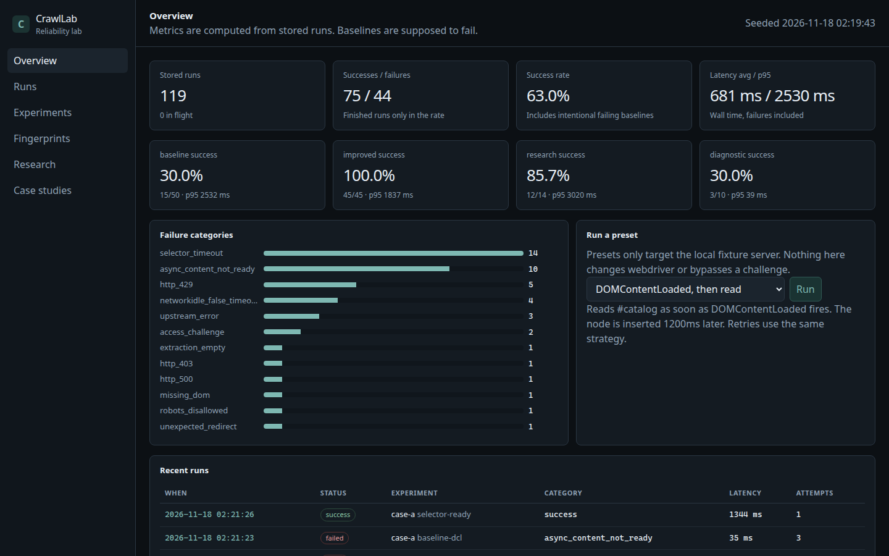
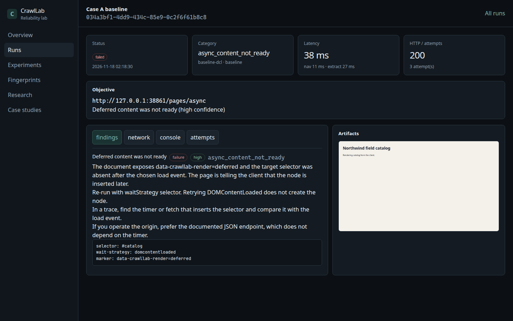
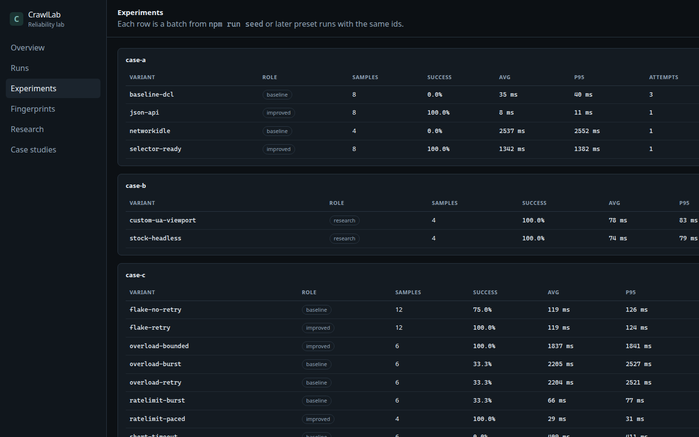
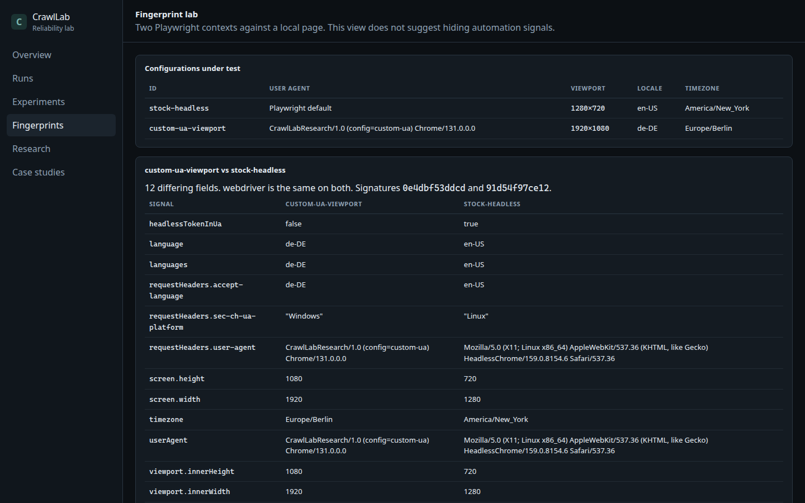

# CrawlLab

CrawlLab is a local browser-automation lab. It runs Playwright against a fixture server you control, records what the browser actually did, and explains failed runs with evidence and a confidence level. The dashboard is filled by those runs. It does not ship sample metrics.

The lab is for authorized testing. Targets default to loopback. External hosts stay off unless `ALLOW_EXTERNAL=true` and the host is allowlisted, and robots.txt is still enforced. Nothing in this repo hides `navigator.webdriver`, solves a CAPTCHA, or bypasses an access challenge.

## What it measures

- Navigation, selector waits, HTTP status, redirects, console errors, failed subresources, screenshots, and Playwright traces.
- A job queue with a concurrency cap, per-attempt timeouts, equal-jitter exponential backoff, and an optional per-host token bucket.
- Browser-pool recovery after the browser process is closed.
- Two browser configurations on a local fingerprint page, including CDP `Browser.getVersion`.
- A minified gate script: beautify, constant-fold the string table, simulate branches in `node:vm`, then confirm the teaser and partial branches in Chromium.

## Run it

Requirements: Node.js 22 or newer.

```bash
npm install
npx playwright install chromium
cp .env.example .env   # optional
npm run seed           # real runs against the fixture server; writes results/benchmarks.json
npm run dev            # API on :43123, dashboard on :43125
```

Open [http://127.0.0.1:43125](http://127.0.0.1:43125). Production, after `npm run build`, is `npm start` on [http://127.0.0.1:43123](http://127.0.0.1:43123) (the API serves `web/dist`).

`npm test` runs unit and integration tests. `npm run test:e2e` runs Playwright against the fixture server. `npm run analyze:gate` regenerates the gate-script report.

The walkthrough for a live failure, a fix, and the measured comparison is [DEMO.md](DEMO.md).

## Measured results

<!-- bench:summary -->
Generated 2026-11-18T02:19:43.931Z by `npm run seed`. Node v22.23.4, linux 6.12.113+ x64, 4× Intel(R) Xeon(R) Processor. Playwright 1.65.1, browser channel `chromium`, CDP HeadlessChrome/159.0.8154.6.

Stored runs: 116. Finished success rate (includes intentional baselines): 63.8%.

| Variant | Role | Samples | Successes | Success rate | Avg ms | p95 ms | Avg attempts | Failure categories |
| --- | --- | ---: | ---: | ---: | ---: | ---: | ---: | --- |
| baseline-dcl | baseline | 8 | 0 | 0% | 34.6 | 40 | 3 | async_content_not_ready 8 |
| json-api | improved | 8 | 8 | 100% | 8 | 11 | 1 | — |
| networkidle | baseline | 4 | 0 | 0% | 2536.8 | 2552 | 1 | networkidle_false_timeout 4 |
| selector-ready | improved | 8 | 8 | 100% | 1342 | 1382 | 1 | — |
| custom-ua-viewport | research | 4 | 4 | 100% | 77.5 | 83 | 1 | — |
| stock-headless | research | 4 | 4 | 100% | 73.5 | 79 | 1 | — |
| flake-no-retry | baseline | 12 | 9 | 75% | 119.3 | 126 | 1 | upstream_error 3 |
| flake-retry | improved | 12 | 12 | 100% | 119.3 | 124 | 1.25 | — |
| overload-bounded | improved | 6 | 6 | 100% | 1837.2 | 1841 | 1 | — |
| overload-burst | baseline | 6 | 2 | 33.3% | 2205 | 2527 | 1 | selector_timeout 4 |
| overload-retry | baseline | 6 | 2 | 33.3% | 2204.2 | 2521 | 2.33 | selector_timeout 4 |
| ratelimit-burst | baseline | 6 | 2 | 33.3% | 66.3 | 77 | 1 | http_429 4 |
| ratelimit-paced | improved | 4 | 4 | 100% | 29 | 31 | 1 | — |
| short-timeout | baseline | 6 | 0 | 0% | 409 | 411 | 4 | selector_timeout 6 |
| sufficient-timeout | improved | 6 | 6 | 100% | 1330.8 | 1348 | 1 | — |
| gate-expect-full | research | 2 | 0 | 0% | 3017 | 3020 | 1 | access_challenge 2 |
| gate-partial | research | 2 | 2 | 100% | 51 | 53 | 1 | — |
| gate-teaser | research | 2 | 2 | 100% | 49 | 50 | 1 | — |
<!-- /bench:summary -->

## Dashboard

These shots are the running app. The overview includes the seed plus the demo runs from [DEMO.md](DEMO.md), so its headline count is a few runs higher than the table above. The table is only `npm run seed`.









## Layout

| Path | Role |
| --- | --- |
| `src/engine` | Playwright pool, CDP version probe, one attempt |
| `src/reliability` | Queue, backoff, token bucket, retry decision |
| `src/diagnostics` | Evidence to findings, with confidence |
| `src/fixtures` | Local origin: pages, robots.txt, injected faults |
| `src/re` | Minify, AST fold, `node:vm` simulation |
| `src/api` | Fastify. Presets only; no free-form external URL |
| `web` | Vite + React dashboard |
| `docs` | Architecture, ADRs, case studies |

## Docker

`Dockerfile` uses `mcr.microsoft.com/playwright:v1.65.1-noble` so the image matches the Playwright version in `package.json`. Compose publishes port 43123 and stores SQLite on a volume.

```bash
docker compose build
docker compose up
docker compose run --rm crawllab npm run seed
```

This environment did not have a Docker daemon, so the image was not built here. See the limitations below.

## Configuration

See `.env.example`. The defaults bind the API to `43123`, the fixture server to `43124`, and keep `ALLOW_EXTERNAL` false. There are no API keys.

## Limitations

- Benchmarks describe this machine and this Playwright build. Re-run `npm run seed` before quoting them elsewhere. The seed replaces the marked sections in this file and the case studies.
- `networkidle` on the async fixture is a false failure by design: a heartbeat keeps the network busy after the catalog exists.
- The overload batch depends on in-flight overlap. The case study reports the counts that actually happened, including when overlap was imperfect.
- Headed Chromium was not required. Runs are headless.
- Docker was not executed in the environment used to produce the committed numbers.
- The gate script's `full` branch is executed only inside `node:vm` with a mocked `navigator`. Chromium is left with `navigator.webdriver === true`.

## License

MIT.
